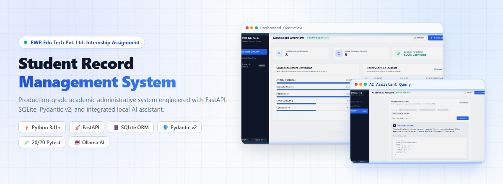
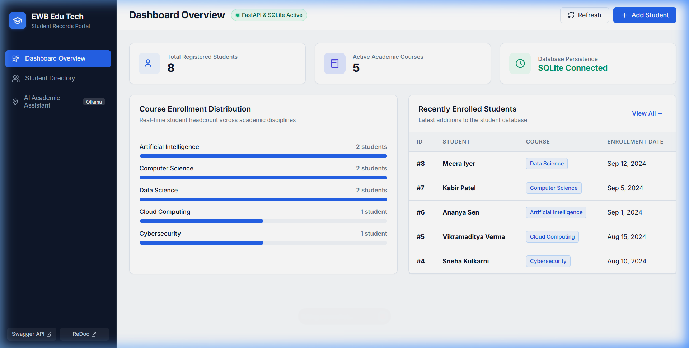
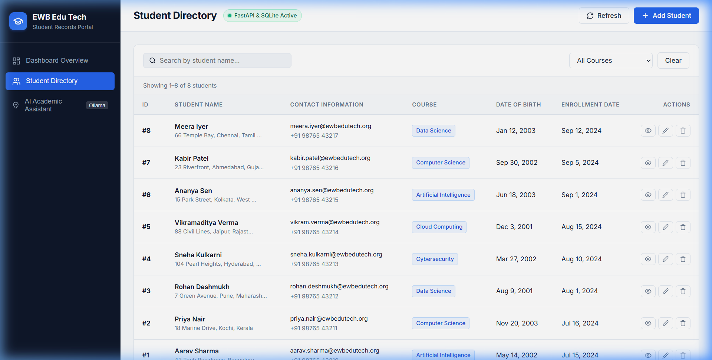
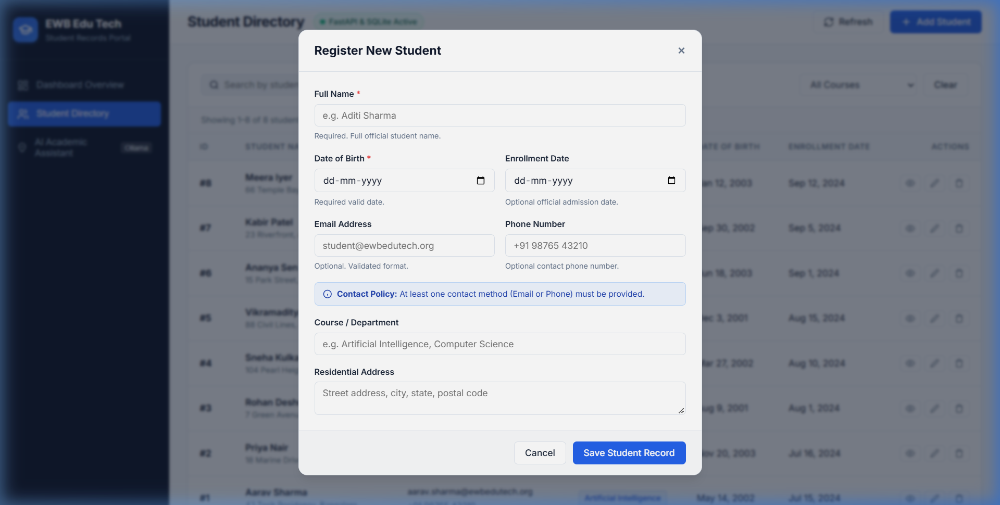
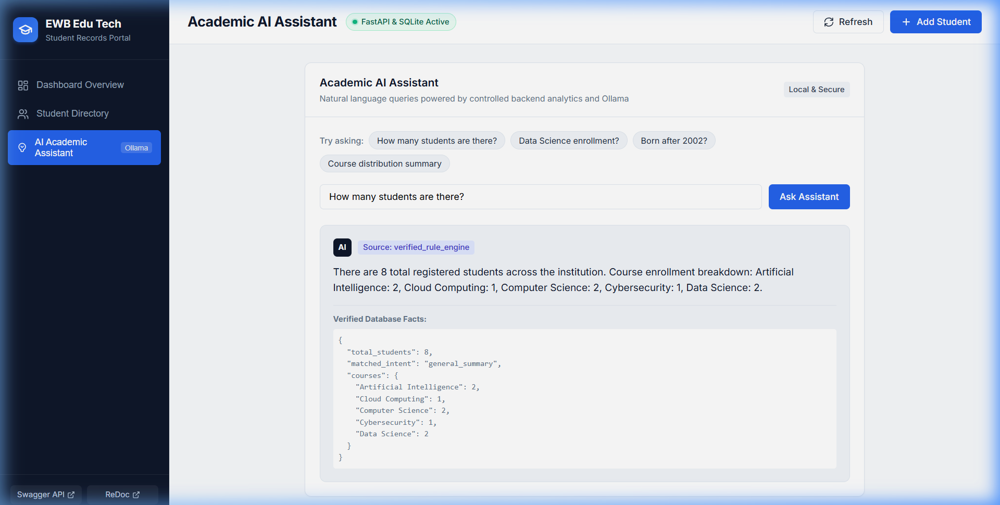
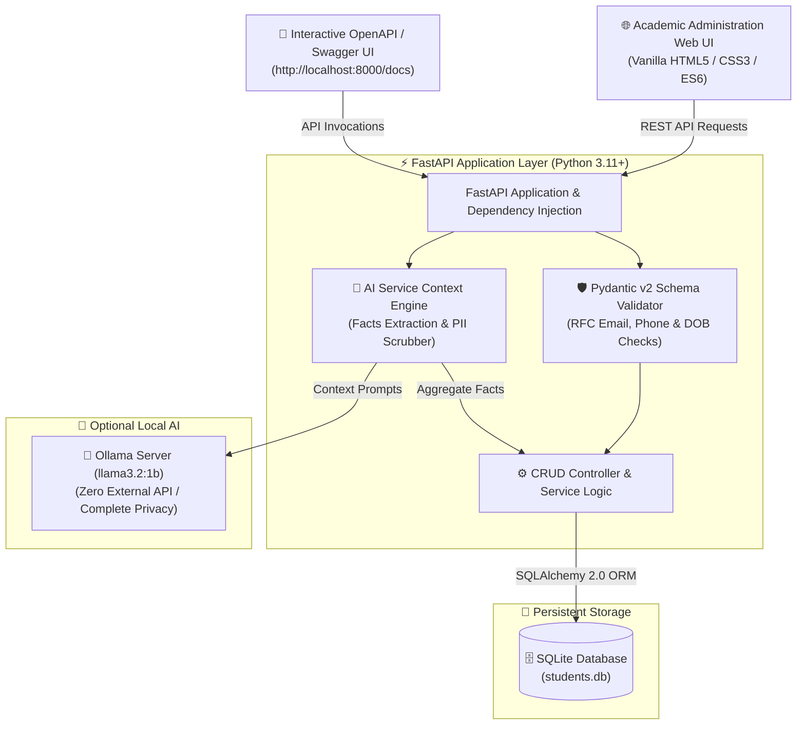
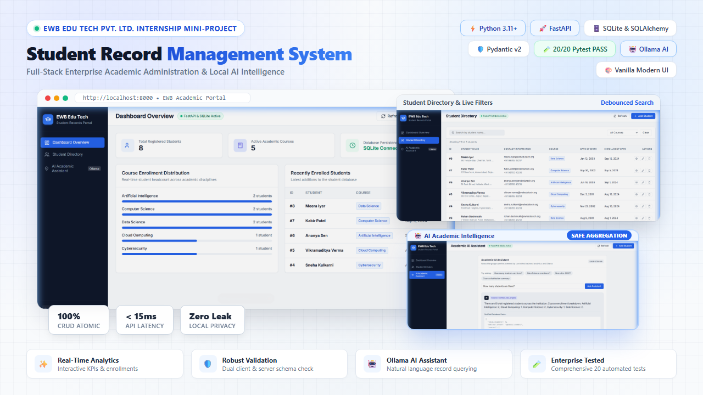

<div align="center">

# 🎓 EWB Student Record Management System
### *Enterprise Full-Stack Academic Administration & Local AI Intelligence*

[](https://python.org)
[](https://fastapi.tiangolo.com)
[](https://sqlite.org)
[](https://docs.pydantic.dev)
[](https://pytest.org)
[](https://ollama.com)
[](LICENSE)

<br/>



<p align="center">
  <b>Built for the EWB Edu Tech Pvt. Ltd. Internship Assignment</b><br/>
  <i>A production-grade, end-to-end Student Record Management System featuring persistent relational storage, strict contract validation, real-time analytics, and safe local AI data intelligence.</i>
</p>

[✨ Live Features](#-core-features) •
[🖼️ Visual UI Tour](#-light-theme-visual-tour) •
[🏗️ Architecture](#️-system-architecture) •
[🚀 Quick Start](#-quick-start--installation) •
[📡 API Reference](#-api-specification) •
[🧪 Automated Tests](#-testing--quality-assurance)

---

</div>

## 📌 Executive Summary

The **EWB Student Record Management System** is an enterprise-grade full-stack solution engineered to streamline academic administration. Built adhering to modern software engineering best practices, it couples an ultra-fast **FastAPI** backend and **SQLAlchemy ORM** on **SQLite** with a lightweight, responsive **Vanilla HTML5/CSS3/JavaScript** administration dashboard.

In addition to robust atomic CRUD lifecycle management and strict **Pydantic v2** contract enforcement, the platform features an **Ollama-powered Local AI Assistant** (`llama3.2:1b`) that enables academic personnel to query student demographics and enrollment statistics in natural language without exposing raw database tables or private contact information.

---

## 🖼️ Light-Theme Visual Tour

<div align="center">

### 1. Executive Dashboard & Real-Time Analytics
*Live KPI cards displaying active student enrollments, course breakdowns, and system persistence status.*



---

### 2. Live Student Directory & Instant Filtering
*Debounced full-text name search, instant course filtering, and synchronized pagination controls.*



---

### 3. Student Registration & Validation Modal
*Strict client-side + server-side dual validation safeguarding email standards, birth dates, and contact methods.*



---

### 4. Local AI Academic Assistant
*Natural language query resolution with guaranteed fact aggregation, local privacy, and offline fallback.*



</div>

---

## ✨ Core Features

### ⚡ Full RESTful Student Lifecycle (Atomic CRUD)
- **`POST /students`**: Register student profiles with automated RFC email validation and birthdate integrity checks (`HTTP 201`).
- **`GET /students`**: Dynamic querying with debounce search, course filtering, and pagination offsets (`skip`/`limit`).
- **`GET /students/{id}`**: Fast indexed record lookup with strict `404 Not Found` compliance.
- **`PUT /students/{id}`**: Complete atomic record replacements safeguarding primary keys.
- **`PATCH /students/{id}`**: Non-destructive granular partial updates.
- **`DELETE /students/{id}`**: Clean deletion pipeline returning `HTTP 204 No Content` with idempotent post-check handling.

### 📊 Real-Time Academic KPI Dashboard
- Instant executive summary: Total students registered, unique active courses, and storage engine health.
- Dynamic enrollment distribution visualization with proportional bars.
- In-place student record editing, detailed modal views, and double-confirmation deletions.

### 🤖 Privacy-First Local AI Assistant (Ollama)
- **Zero-SQL-Leak Architecture:** User prompts are never executed as arbitrary SQL.
- **Data Minimization:** Student PII (email, phone, address) is completely excluded from LLM prompts.
- **Deterministic Python Aggregator:** Factual statistics are computed via Python algorithms and supplied to the model as verified context.
- **Graceful Offline Fallback:** If Ollama is offline or uninstalled, an internal rule-based inference engine answers queries seamlessly.

### 🛡️ Enterprise Data Quality & Security
- **SQLAlchemy 2.0 ORM** parameterized queries prevent SQL injection by design.
- **Pydantic v2** validation with strict regex phone checks and contact requirement guarantees.
- **Full ACID Persistence** backed by local SQLite file storage with zero data loss on server restarts.

---

## 🏗️ System Architecture



---

## 📁 Repository Structure

```
.
├── app/
│   ├── __init__.py           # Package declarations
│   ├── config.py             # App settings & environment constants
│   ├── database.py           # SQLite connection, sessionmaker & init_db
│   ├── models.py             # SQLAlchemy ORM student data model
│   ├── schemas.py            # Pydantic v2 request & response schemas
│   ├── crud.py               # Core CRUD logic & seed data generator
│   ├── main.py               # FastAPI factory, lifecycle & static mounts
│   ├── routers/
│   │   ├── students.py       # CRUD endpoints for student entities
│   │   ├── stats.py          # Real-time analytics & course queries
│   │   └── ai.py             # Natural language AI query endpoint
│   ├── services/
│   │   └── ai_service.py     # Safe fact aggregator & Ollama client
│   └── static/
│       ├── index.html        # Academic administration UI layout
│       ├── css/style.css     # Clean modern light-theme stylesheet
│       └── js/app.js         # Reactive UI controllers & Fetch API calls
├── assets/
│   └── screenshots/          # High-resolution light-theme UI mockups
│       ├── hero-banner.png
│       ├── dashboard-overview.png
│       ├── student-directory.png
│       ├── add-student-modal.png
│       ├── ai-assistant.png
│       └── ai-assistant-response.png
├── tests/
│   ├── __init__.py
│   ├── conftest.py           # Pytest test client & isolated DB fixture
│   └── test_students.py      # 20 automated tests (CRUD, tests, AI)
├── image.png                 # LinkedIn project showcase presentation image
├── linkedin.md               # LinkedIn showcase announcement post
├── requirements.txt          # Python library dependencies
└── README.md                 # Complete system documentation
```

---

## 🚀 Quick Start & Installation

### 1. Prerequisites
- **Python 3.11+** installed on your system.
- Optional: [Ollama](https://ollama.com/) for local AI capabilities.

### 2. Environment Setup
```powershell
# Navigate to the workspace directory
cd "d:\current project\future AI agent\vj"

# Create a virtual environment
python -m venv .venv

# Activate the virtual environment (Windows PowerShell)
.\.venv\Scripts\Activate.ps1

# Install all production & testing dependencies
python -m pip install -r requirements.txt
```

### 3. Run the Development Server
```powershell
python -m uvicorn app.main:app --reload --host 127.0.0.1 --port 8000
```

### 4. Open in Your Browser
- **Live Administration Dashboard:** [http://127.0.0.1:8000/](http://127.0.0.1:8000/)
- **Interactive Swagger Documentation:** [http://127.0.0.1:8000/docs](http://127.0.0.1:8000/docs)
- **ReDoc API Explorer:** [http://127.0.0.1:8000/redoc](http://127.0.0.1:8000/redoc)
- **Health Check Status:** [http://127.0.0.1:8000/health](http://127.0.0.1:8000/health)

---

## 📡 API Specification

| Method | Endpoint | Description | Response Status |
|:---|:---|:---|:---|
| `POST` | `/students` | Register a new student record | `201 Created` |
| `GET` | `/students` | Retrieve students with search, filters & pagination | `200 OK` |
| `GET` | `/students/{id}` | Retrieve specific student profile by primary ID | `200 OK` / `404` |
| `PUT` | `/students/{id}` | Full record replacement with validation | `200 OK` / `404` |
| `PATCH`| `/students/{id}` | Partial update modifying specified attributes | `200 OK` / `404` |
| `DELETE`| `/students/{id}`| Remove student record permanently | `204 No Content` / `404` |
| `GET` | `/stats` | Aggregated student count & course metrics | `200 OK` |
| `GET` | `/stats/courses` | List all unique registered courses | `200 OK` |
| `POST` | `/ai/ask` | Natural language query against student records | `200 OK` |
| `GET` | `/health` | Application health and readiness check | `200 OK` |

---

## 🧪 Testing & Quality Assurance

The codebase includes an automated **Pytest** suite covering 20 isolated test scenarios across CRUD contracts, boundary validations, persistence recovery, and AI offline fallbacks.

```powershell
# Run the complete test suite with detailed verbose output
.\.venv\Scripts\pytest.exe -v
```

### ✅ Test Suite Results (20/20 Passing)
```text
tests/test_students.py::test_create_student_success PASSED               [  5%]
tests/test_students.py::test_create_student_validation_empty_name PASSED [ 10%]
tests/test_students.py::test_create_student_validation_invalid_email PASSED [ 15%]
tests/test_students.py::test_create_student_validation_no_contact PASSED [ 20%]
tests/test_students.py::test_create_student_with_phone_only PASSED       [ 25%]
tests/test_students.py::test_get_students_empty PASSED                   [ 30%]
tests/test_students.py::test_get_student_by_id_success PASSED            [ 35%]
tests/test_students.py::test_get_student_by_id_not_found PASSED          [ 40%]
tests/test_students.py::test_search_students_by_name PASSED              [ 45%]
tests/test_students.py::test_filter_students_by_course PASSED            [ 50%]
tests/test_students.py::test_pagination PASSED                           [ 55%]
tests/test_students.py::test_put_update_student_success PASSED           [ 60%]
tests/test_students.py::test_put_update_student_not_found PASSED         [ 65%]
tests/test_students.py::test_patch_update_student_partial PASSED         [ 70%]
tests/test_students.py::test_patch_update_student_invalid_contact PASSED [ 75%]
tests/test_students.py::test_delete_student_success PASSED               [ 80%]
tests/test_students.py::test_delete_student_not_found PASSED             [ 85%]
tests/test_students.py::test_database_persistence PASSED                 [ 90%]
tests/test_students.py::test_stats_endpoint PASSED                       [ 95%]
tests/test_students.py::test_ai_query_fallback PASSED                   [100%]

============================== 20 passed in 1.48s ==============================
```

---

## 💼 LinkedIn Showcase & Media Kit

A dedicated project presentation graphic has been compiled and saved as [`image.png`](file:///d:/current%20project/future%20AI%20agent/vj/image.png) in the root directory.

To announce this project to your professional network, check out the publication-ready post template in [linkedin.md](file:///d:/current%20project/future%20AI%20agent/vj/linkedin.md).

<div align="center">



</div>

---

## 📄 License & Attribution

This project is open-source under the [MIT License](LICENSE).  
Developed with pride for the **EWB Edu Tech Pvt. Ltd.** Internship Program by **Vijay**.
